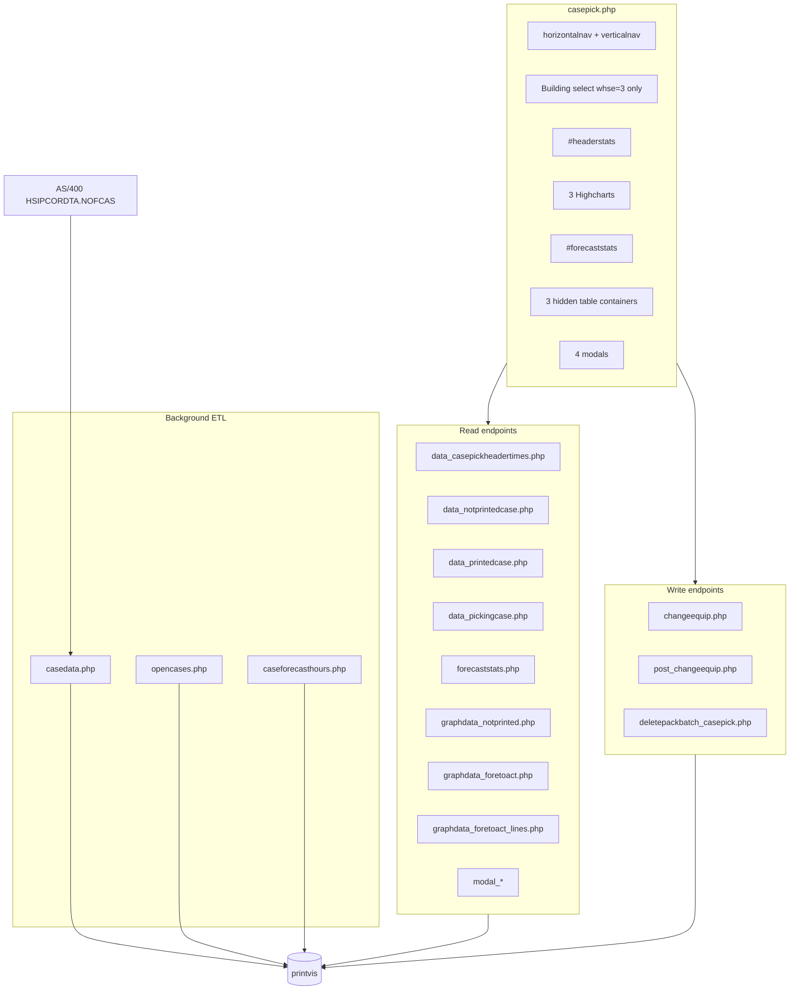

# Case Pick Page — Complete Technical Analysis

**Page:** `casepick.php` (route: `/printvis/casepick.php`)  
**Scope:** Display on this page only (excludes `monitor_casepicktimes.php`)  
**Schema:** `printvis` (MySQL) unless noted  
**Refactor target:** Same PHP/jQuery stack, cleaner structure — preserve business logic  
**Analysis date:** 2026-05-27  

---

## 1. Executive Summary

The **Case Pick** dashboard shows warehouse case-pick labor demand in three workflow stages—**not printed**, **printed waiting to pick**, and **actively picking**—plus forecast-vs-actual charts and staffing narrative. The page is a **read-mostly presentation layer** over MySQL tables populated by scheduled PHP ETL jobs. It does not compute batch travel times or header totals in the browser.

**Data refresh model:**

- Background: `datapull/caserefresh.bat` runs `casedata.php` then `opencases.php` (looped via `psscript_caserefresh.ps1` every 60s during hours 1–23).
- UI: On `$(document).ready` and every **245 seconds**, `refreshall()` reloads header, three charts, and forecast stats. Detail tables load only when the user clicks a header KPI tile.

**User writes (limited):** equipment allocation counts, per-batch equipment type, soft-delete of printed/picking batches.

**Highest migration risk:** Losing ETL dependencies, warehouse-specific elapsed-time offsets, box-release time reduction, and print-cutoff gating—not losing PHP file layout.

---

## 2. Page Purpose and Current Behavior

### 2.1 Business purpose

Operations supervisors use Case Pick to answer:

- How many **hours of case-pick labor** are tied up in each stage right now?
- How does **today’s actual volume** compare to **forecast** by hour and equipment?
- Do we have enough **TSM hours** available vs forecast (including volume-adjusted forecast)?
- Which **batches** drive the time, and can we adjust equipment or hide irrelevant batches?

### 2.2 User interactions

| Action | Behavior |
|--------|----------|
| Page load | `refreshall()` → header + 3 charts + forecast stats |
| Change building (whse 3 only) | `onChange="refreshall()"` |
| Click “Total Hours not Printed” tile | `ajaxpull_notprinted()` → table in `#ctn_notprintedcases` |
| Click “Total Hours Printed…” tile | `ajaxpull_printed()` |
| Click “Total Hours Remaining in Picking” tile | `ajaxpull_picking('batch',' asc')` |
| Click column header | `.click_sort` toggles asc/desc, re-fetches active table |
| Click batch ID (underlined) | Opens modal with tote-level detail |
| “Modify Equipment Usage” | Opens equip allocation modal |
| Delete selected batches | POST delete → full page reload |
| Change equipment on modal | POST `changeequip.php` → full reload |

### 2.3 System/data flow



---

## 3. Relevant Files Reviewed

| Role | Path |
|------|------|
| Page shell | `casepick.php` |
| Nav link | `verticalnav.php` — `<li id="casepick">` → `casepick.php` |
| Session auth | `sessioninclude.php` — redirects if `$_SESSION['Login'] != 'YES'` |
| DB (page shell) | `../Off_System_Slotting/connection/connection_details.php` |
| DB (most AJAX) | `../../connections/conn_printvis.php` or `../../CustomerAudit/connection/connection_details.php` |
| Time formatting | `functions/functions_totetimes.php` — `_convertToHoursMins`, `_equipestimator`, etc. |
| Timezone | `timezoneset.php` — per-warehouse TZ and `$mintosubtract` |
| Header fragment | `globaldata/data_casepickheadertimes.php` |
| Tables | `globaldata/data_notprintedcase.php`, `data_printedcase.php`, `data_pickingcase.php` |
| After cutoff UI | `globaldata/aftercutoff.php` |
| Charts JSON | `globaldata/graphdata_notprinted.php`, `graphdata_foretoact.php`, `graphdata_foretoact_lines.php` |
| Forecast narrative | `globaldata/forecaststats.php` |
| Modals | `globaldata/modal_notprintedbatch.php`, `modal_printedbatch.php`, `modal_pickingbatch.php`, `modal_equipalloc.php` |
| Writes | `formpost/post_changeequip.php`, `changeequip.php`, `deletepackbatch_casepick.php` |
| ETL — printed/picking | `datapull/casedata.php` |
| ETL — not printed + hour buckets | `datapull/opencases.php` |
| ETL — forecast minutes | `datapull/caseforecasthours.php` |
| Schedule | `datapull/caserefresh.bat`, `datapull/psscript_caserefresh.ps1` |
| Forecast ML (Unconfirmed) | `datapull/update_histcasevol.bat` → R `boosted_tree.R` |

### 3.1 Dead / fragile code on page

- **Duplicate DOM id:** `#forecaststats` appears twice (lines 91 and 111 in `casepick.php`); AJAX targets first match only.
- **`debugger` statements** in click handlers for printed batch and delete buttons (`casepick.php` ~717, 789, 813).
- **Duplicate handler:** `#stat_beingpicked` click bound twice (lines 222–227 and 349–352).
- **Countdown vs interval mismatch:** Timer starts at 240s; `setInterval` is 245000ms.

---

## 4. System/Data Flow Overview

### 4.1 Page initialization (`casepick.php`)

Warehouse **3 (Sparks)** sees building selector (1 or 2); other warehouses hide it and use building **1** implicitly in most endpoints. User warehouse comes from `prodvisdb_users_PRIMDC` via session `MYUSER`.

### 4.2 Auto-refresh

`setInterval(..., 245000)` calls `refreshheaderdata()`, all three chart loaders, and `ajaxpull_forecaststats()`. Open detail tables are **not** auto-refreshed.

### 4.3 Warehouse resolution (repeated pattern)

Nearly every endpoint: session user → `prodvisdb_users` → `$var_whse` / `$whsesel` + POST/GET `building` (`intval`).

---

## 5. Complete Table and Data Source Inventory

| Table / source | Purpose on page | Read/Write | Populated by |
|----------------|-----------------|------------|--------------|
| `prodvisdb_users` | User → primary DC | Read | User admin |
| `casevis_hourbuckets` | Header KPIs, hours chart | Read | `opencases.php` INSERT |
| `notprintedcasebatches_time` | Not-printed table | Read | `opencases.php` rebuild |
| `notprintedcasetote_time` | Not-printed modal | Read | `opencases.php` |
| `casebatches_time` | Printed + picking tables | Read | `casedata.php` + `opencases.php` |
| `casetote_time` | Printed/picking modals | Read | `casedata.php` |
| `casebatchstarttime` | Picking, elapsed/remaining | Read | `casedata.php` ← AS/400 `NOFCAS` |
| `case_boxesreleased` | Box release % | Read | `casedata.php` |
| `casebatchdelete` | Soft-delete filter | Read + Write | Page INSERT; job purge |
| `case_equipmentcount` | Equip modal, batch sizing | Read + Write | **Unconfirmed** seed; page UPDATE |
| `case_batchequip` | Per-batch equip override | Write | `changeequip.php` |
| `forecast_case` | F2A charts, forecast stats | Read | `caseforecasthours.php` + **Unconfirmed** R |
| `case_actuallaborbyhour` | Actuals | Read | `opencases.php` INSERT |
| `tsmshift` | Available hours, breaks | Read | **Unconfirmed** |
| `pm_casetimes` | Time standards (ETL) | ETL only | **Unconfirmed** |
| `casesnotprinted`, `casesnotprinted_bybatch` | Not-printed ETL | ETL only | `opencases.php` |
| `openbatches_case` | Printed ETL | ETL only | `casedata.php` |
| `pickprediction_casemap`, `aisle_coor` | Travel (ETL) | ETL only | **Unconfirmed** |
| `HSIPCORDTA.NOFCAS` | Pick starts | ETL only | AS/400 |

### 5.1 Join keys

| Join | Keys |
|------|------|
| Batch ↔ start time | `starttime_whse/build/batch` = `casebatches_whse/build/cart` |
| Batch ↔ boxes released | `boxrel_batch = casebatches_cart` |
| Batch ↔ soft delete | `casebatches_cart = casedelete_batch` (filter NULL) |
| Picking ↔ shift | `SHIFT_TSMNUM = starttime_tsm` |
| Forecast ↔ actual | hour, whse, build, date, equip |

---

## 6. Table Update Flow Analysis

### 6.1 Page-initiated writes

| Trigger | File | Tables |
|---------|------|--------|
| Save equipment counts | `formpost/post_changeequip.php` | UPDATE `case_equipmentcount` (PJ, BELTLINE, ORDERPICKER) |
| Change batch equipment | `formpost/changeequip.php` | UPDATE `case_batchequip` |
| Delete batches | `formpost/deletepackbatch_casepick.php` | INSERT `casebatchdelete` |
| Building change | `refreshall()` | None (re-read only) |

**Delete:** Soft delete — `casedelete_batch`, `casedelete_table` (`printed`|`picking`), `casedelete_date`. Full page reload.

**Equipment counts:** Effect on displayed not-printed batches after next `opencases.php` (`batchsizeestimate = ceil(count / equipment_count)`).

### 6.2 Background jobs

| Job | Updates for this page |
|-----|----------------------|
| `casedata.php` | `casebatches_time`, `casetote_time`, `casebatchstarttime`, `case_boxesreleased`, `openbatches_case`, etc. |
| `opencases.php` | `notprintedcasebatches_time`, `notprintedcasetote_time`, INSERT `casevis_hourbuckets`, INSERT `case_actuallaborbyhour` |
| `caseforecasthours.php` | **Unconfirmed** — `forecast_case` for today |

Schedule: `caserefresh.bat` → both PHP scripts; `psscript_caserefresh.ps1` loops every 60s (hours 1–23).

### 6.3 Page and core metrics

Header/table minute totals are **not** calculated in AJAX handlers—only formatted (`_convertToHoursMins`) and display rules (red rows, lunch text).

---

## 7. Field-Level Data Lineage

**Convention:** Times in **minutes**; display via `_convertToHoursMins()` → `HH:MM`.

### 7.1 Header (`data_casepickheadertimes.php`)

Latest `casevis_hourbuckets` row: `MAX(hourbucket_datetime)` for whse + building.

| Display label | Source |
|---------------|--------|
| Total Hours Needed | `notprinted + printed + picking` |
| Total Hours not Printed | `hourbucket_notprinted` |
| Total Hours Printed Waiting… | `hourbucket_printed` |
| Total Hours Remaining in Picking | `hourbucket_picking` |
| Last refresh | PHP `date('H:i:s')` — **not** `hourbucket_datetime` |
| Countdown | 240s timer vs 245s AJAX — **mismatch** |

### 7.2 Not-printed (`data_notprintedcase.php`)

If local time > **17:07** → `aftercutoff.php`. Else `notprintedcasebatches_time`: Batch, Equipment, Lines, Projected time (`casebatches_time_final`).

### 7.3 Printed (`data_printedcase.php`)

`starttime_tsm IS NULL`, not soft-deleted. Projected time = `casebatches_time_final * (1 - boxrel_relcount/boxrel_boxcount)`. Red if boxes released > 0. REACH summary = batch count.

### 7.4 Picking (`data_pickingcase.php`)

Filters: latest start per batch+TSM; remaining > -35; release < 90%; not deleted.

Elapsed: `TIMESTAMPDIFF(MINUTE, start, NOW()) - offset` (whse 7: -60, whse 3: -180). REACH: 0 elapsed/remaining in SQL.

**Bug:** Lunch column uses `SHIFT_BREAK1` for lunch window, not `SHIFT_LUNCH`.

### 7.5 Charts

| Chart | Endpoint | Data |
|-------|----------|------|
| Hours Needed over Time | GET `graphdata_notprinted.php` | Today’s `casevis_hourbuckets` — 6 JSON series |
| Forecast to Actual (hours) | GET `graphdata_foretoact.php` | `forecast_case` + `case_actuallaborbyhour` — 9 series |
| Warehouse Lines F2A | GET `graphdata_foretoact_lines.php` | Same, lines not minutes |

Y-axis minutes; labels `floor(y/60)`. F2A hides column series 0–2, 4–6 in JS.

### 7.6 Forecast stats (`forecaststats.php`)

Available hours from `tsmshift` (90% effective). Forecast sum today. Trend vs current hour (whse 3: `HOUR(NOW())-3`, min 6; whse 7: `-1`). TSM equivalents ÷ 6.75 or 7.

### 7.7 Modals

| Modal | Table |
|-------|-------|
| Not printed | `notprintedcasetote_time` |
| Printed/picking | `casetote_time` + equip change |
| Equipment | `case_equipmentcount` |

---

## 8. API Contract Analysis

All require `sessioninclude.php` (`Login=YES`). No role check (**Unconfirmed**).

### Read

| Method | Route | Params | Response |
|--------|-------|--------|----------|
| POST | `globaldata/data_casepickheadertimes.php` | `building` | HTML + countdown script |
| POST | `globaldata/data_notprintedcase.php` | `building`, `orderby`, `sort_class` | HTML or aftercutoff |
| POST | `globaldata/data_printedcase.php` | same | HTML table |
| POST | `globaldata/data_pickingcase.php` | same | HTML table |
| POST | `globaldata/forecaststats.php` | `building` | HTML blockquotes |
| GET | `globaldata/graphdata_notprinted.php` | `building` | JSON [6 series] |
| GET | `globaldata/graphdata_foretoact.php` | `building` | JSON [9 series] |
| GET | `globaldata/graphdata_foretoact_lines.php` | `building` | JSON [9 series] |
| POST | `globaldata/modal_*` | `batch`, `building` | HTML |

### Write

| Method | Route | Body |
|--------|-------|------|
| POST | `formpost/post_changeequip.php` | `count_pj`, `count_belt`, `count_op`, `building` |
| POST | `formpost/changeequip.php` | `newequip`, `batchid`, `building` |
| POST | `formpost/deletepackbatch_casepick.php` | `deletearray`, `deletearraycount`, `tableid` |

**Security:** String-interpolated SQL throughout — refactor must use bound parameters.

---

## 9. Business Logic and Assumptions

| Rule | Risk if lost |
|------|--------------|
| Print cutoff 17:07 | Wrong end-of-day UI |
| Building 1/2 for whse 3 only | Wrong data slice |
| Printed = no pick start (`starttime_tsm IS NULL`) | Wrong bucket |
| Picking filters (-35 min, 90% release) | Wrong active list |
| Box release reduces printed time | Overstated labor |
| REACH: count not time in summaries | Misleading KPIs |
| Equipment enum: PALLETJACK, BELTLINE, ORDERPICKER, REACH | Bad assignments |
| Forecast hour mapping per whse | Wrong trend text |
| 90% shift effective | Wrong capacity |
| Soft delete via `casebatchdelete` | Deleted batches reappear |
| Auto-refresh 245s | Stale expectations |
| Sort asc/desc on columns | UX regression |

---

## 10. Edge Cases and Error Handling

- Empty `casevis_hourbuckets` → possible PHP error on `[0]`
- Printed table: `orderby` may be unset on first load
- Duplicate `#forecaststats` → second panel never updated
- No rollback on writes; no CSRF tokens
- NULL box release → treated as full time in aggregates (`CASE WHEN ... IS NULL THEN 1`)

---

## 11. Auth, Permissions, and Security

- Auth: session `Login=YES` only
- Warehouse scope: `prodvisdb_users_PRIMDC`
- **Unconfirmed:** role restrictions for delete/equip
- SQL injection risk: high (interpolated user id, batch, building)

---

## 12. Performance

- No pagination on batch tables
- Picking query uses correlated subqueries on `casebatchstarttime`
- Auto-refresh: 4 AJAX + 3 chart rebuilds every 245s per client
- ETL: unbounded memory, long execution — off-request

---

## 13. Refactor Risks

| Risk | Severity | Test |
|------|----------|------|
| Datapull stopped | High | MAX(`hourbucket_datetime`) freshness |
| Wrong elapsed offsets | High | whse 3 vs 7 picking row |
| Box release NULL | Medium | NULL `boxrel_*` batch |
| Print cutoff | Medium | Request after 17:07 |
| Equip count delay | Medium | Save → run opencases → verify batches |
| SQL injection | High | Parameterize queries |

---

## 14. Recommended New Architecture

```
casepick.php              → thin shell
assets/js/casepick.js     → AJAX, charts, events
includes/casepick/        → Context, Repository, Services
globaldata/*.php          → thin controllers
```

- Single whse/building resolver
- Whitelist `orderby` columns
- Show `hourbucket_datetime` as “data as of”
- Bound SQL parameters

---

## 15. Open Questions / Unconfirmed

1. Production schedule for `caserefresh.bat`
2. `case_equipmentcount` initial seeding
3. `changeequip.php` → when `casebatches_equipment` updates
4. `forecast_case` source: PHP vs R vs both
5. Permissions beyond login
6. 245s vs 240s intentional?
7. `sessioninclude.php` 30000s vs “30 minutes” comment
8. Full `opencases.php` minute formula parity

---

## 16. Refactor Checklist

| Area | Status |
|------|--------|
| UI + AJAX map | Understood |
| Header + table queries | Understood |
| Charts + forecast narrative | Understood |
| ETL split (casedata / opencases) | Partially — deep travel math |
| forecast_case, tsmshift, pm_casetimes | Unconfirmed |
| Production schedule, AuthZ | Unconfirmed |

---

*Companion: [casepick-engineering-handoff.md](./casepick-engineering-handoff.md)*
